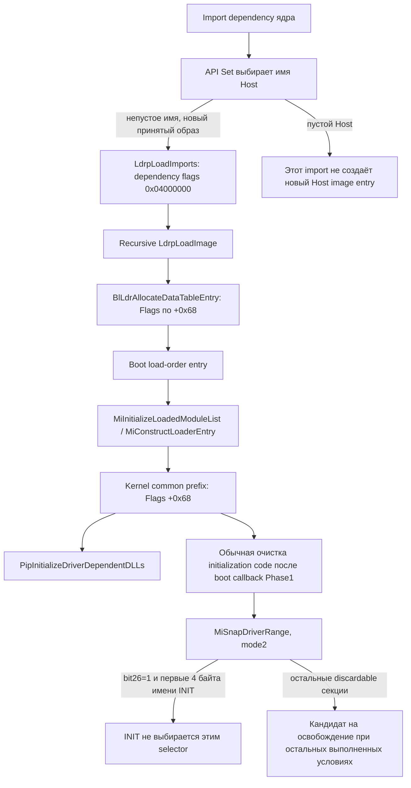

# Загрузка зависимостей и время жизни INIT

Исходные bytes и file offsets: [CODE-EVIDENCE.csv](analysis/evidence/CODE-EVIDENCE.csv); полный контекст — `wf-loader.asm`, `wn-loader.asm`, `{kf,kn}-lifecycle-wnf.asm`, `{kf,kn}-native-extra.asm` в `analysis/evidence/`. Символы имеют ограничения, описанные в VERIFIED.

## Общая доказанная модель



Это граф статических путей, не trace одного запуска. Для 22000 FOS schema действительно содержит `statesepext.sys`; у исходной schema26100 Host отсутствует. Равенство loader mechanics применимо после выбора и принятия образа; оно не устраняет различие binding/policy.

## 22000: прослеженный путь

| Шаг | W22000 / K22000 RVA | Содержание |
|---|---|---|
| LdrpLoadImports | W `0xEF7FC`, установка `0xEF82C` | `mov dword ptr [rbp-0x74],0x04000000` |
| Recursive dependency load | W `0xEFA87..0xEFAC8` | local flags → `[rsp+0x60]` → `LdrpLoadImage` `0xEF0A4` |
| Альтернативная попытка | W `0xEFB79..0xEFBB8` | Те же flags передаются повторной попытке |
| Loader → allocator | W `0xEF49A..0xEF4C2` | Входные flags `[rbp+0x120]` → stack argument `[rsp+0x40]` |
| Allocator | W `0xEFE84 / 0xEFEE5` | EBP читает flags; `mov [rbx+0x68],ebp` |
| Размер полного boot entry | W `0xEFE8B` | `mov ecx,0xE8`, затем BlMmAllocateHeap |
| Конструирование kernel entry | K `0xB16054..0xB1605F` | MiConstructLoaderEntry с mode=1 |
| Prefix copy | K `0x771A1F..0x771A75` | Копирование common блока; `0x771A53/57` переносит `[src+0x60..6F]`, в том числе Flags+0x68 |
| DLL classification consumer | K `0xB02F88` | `test dword ptr [rbx+0x68],0x04000000` |
| Обычная boot cleanup | K `0x8111AE → 0x8111C8` | После возврата Phase1InitializationIoReady |
| Selector | K `0x77BE81 → 0x77C1D0` | MiFreeDriverInitialization вызывает MiSnapDriverRange с R8D=2 |

Дополнительные flags, устанавливаемые после prefix copy, не следует считать независимым доказательством удаления или сохранения bit26. В исследованном boot copy path не найдено его очистки; записи common Flags и условный selector сопоставлены непосредственно.

## 26100: прослеженный путь

| Шаг | W26100 / K26100 RVA | Содержание |
|---|---|---|
| LdrpLoadImports | W `0x19D54C`, установка `0x19D5FB` | Тот же `mov [rbp-0x74],0x04000000` |
| Recursive dependency load | W `0x19D81A..0x19D85B` | Передача flags в LdrpLoadImage; альтернативный путь `0x19D90F..0x19D94E` |
| Loader → allocator | W `0x19D1CB..0x19D1F3` | Входные flags `[rbp+0x150]` → `[rsp+0x40]` |
| Allocator | W `0x19DC20 / 0x19DCDA` | R14D читает flags; `mov [rdi+0x68],r14d` |
| Размер полного boot entry | W `0x19DC27` | `mov ecx,0x120`, затем BlMmAllocateHeap |
| Конструирование kernel entry | K `0xC695A2..0xC695BC` | MiConstructLoaderEntry с mode=`0x10000000` |
| Prefix copy | K `0xAAD995..0xAAD9F3` | Копирует common prefix с Flags+0x68 |
| DLL classification consumer | K `0xC71BF3` | Тот же dependency bit |
| Boot cleanup | K `0x705B9F`, callback `0x7F6610` | Enumerate images после Phase1InitializationIoReady |
| Selector | K `0xA53360 → 0xA53568` | MiFreeDriverInitialization → MiSnapDriverRange |

Winload callbacks `OslpLdrExProcessImportFlags` и `OslpLdrExProcessImageFlags` прочитаны в обоих образах. В рассмотренных ветвях image-policy outputs отделены от dependency-record flags; один факт проверки `0x04000000` callback не означает очистку classification. Полная эквивалентность всех image/CI policies здесь не заявляется.

## Почему INIT остаётся, хотя DISCARDABLE установлен

F имеет exports Phase0=`0x8090`, Phase1=`0x8190`, Phase2=`0x8360` в секции `INIT`. Наличие `IMAGE_SCN_MEM_DISCARDABLE=0x02000000` действительно проверено по PE section header. Но criterion cleanup сложнее одного этого bit.

Сведение проверенных ветвей mode2:

```text
если entry.Flags & 0x04000000:
    если DWORD(section.Name[0:4]) == 0x54494E49: пропустить секцию
затем обычная проверка IMAGE_SCN_MEM_DISCARDABLE
```

K22000: `0x77C349..0x77C367`, ветка `0x77C467..0x77C473`.
K26100: `0xA536F1..0xA5370F`, ветка `0xA53999..0xA539A5`.

`0x54494E49` — little-endian байты `49 4E 49 54` (`INIT`). Проверяются первые четыре байта имени, а не произвольная интерпретация символов PDB. Различие `bt eax,0x1A` в 22000 и `test ...,0x04000000` в 26100 не меняет predicate.

| Loader Flags | Реальная секция F | Результат исследованного predicate в обоих kernels |
|---:|---|---|
| 0 | INIT, DISCARDABLE=1 | Generic discardable candidate |
| `0x04000000` | INIT, DISCARDABLE=1 | Не выбирается этим selector |

Это **candidate decision**, а не утверждение, что generic path всегда немедленно освобождает все страницы. Полный MM lifetime зависит от дополнительных guards/отображений. Сохранённое сведение — [init-selector-reduction.json](analysis/evidence/init-selector-reduction.json).

Отдельные guards обычной очистки:

- Boot image skip `Flags&0x40000000`: K22000 `0x811207`, K26100 `0x7F6614`.
- MiFreeDriverInitialization skip `Flags&0x800`: K22000 `0x77BE49`, K26100 `0xA53389`.

Ни один из них не следует путать с dependency bit26, section DISCARDABLE или API Set SEALED.

## Новый dependency и существующий entry — разные случаи

В обеих версиях LdrpLoadImage содержит merge с уже существующей записью. W22000 `0xEF6E0..0xEF730`, W26100 `0x19D42D..0x19D47F`: при несовпадающей classification incoming/существующей записи используется маска `0xFBFFFFFF`, которая может снять dependency bit. Поэтому утверждение «любая запись, когда-либо встретившаяся в imports, навсегда имеет bit26» неверно.

Результат retention применим к установленному **конечному** Flags конкретного entry. Для реального Host на 26100 такой runtime entry не предоставлен. LoadCount и LoadedImports не превращены в доказательство вечного pin. Address-directed discard, explicit unload и memory-pressure paths нельзя закрыть одним mode2 selector.

## Dependency DLL, export callback и SCM

`PipInitializeDriverDependentDLLs` использует dependency bit в обоих kernels. Затем есть отдельный путь к `MmCallDllInitialize`: K22000 `0xB02F74 → 0x810924`; K26100 `0xC71CF4 → 0x7F60FC`. Оба helpers сначала ищут **export `DllInitialize`**, а современная версия передаёт найденный адрес в `MiIssueDllInitializeCall`.

У предоставленного F нет export `DllInitialize`; есть `DllUnload` и три Phase exports. Его обычная entry цепочка приводит к `F+0x8078`: `mov eax,0xC0000001; ret`. Таким образом, load-time import dependency и вызов конкретных Phase exports принципиально отличаются от запуска F как обычного драйвера через SCM/DriverEntry. Из этого не следует требование запускать service или успешность такого запуска.

## Что реально изменилось

Common prefix обоих kernels имеет Flags+0x68 и size0xA0, но полные boot entries различаются (`0xE8`/`0x120`), а Pip per-image metadata читается по `+0xE4`/`+0x11C`. Также изменён private constructor mode и реализация boot enumeration/locking. Эти различия запрещают слепой перенос частных offsets. Они **не противоречат** совместимости исследованного внешнего Phase ABI: F к этим private records напрямую не обращается через свои 26 imports.
