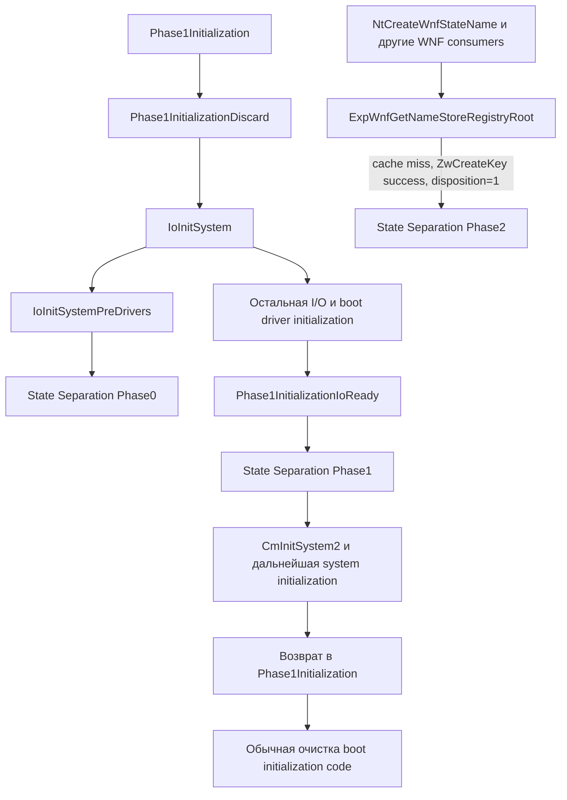

# Реальные вызовы Phase0/1/2 и их контракт

Все адреса — RVA kernels текущего пакета. Ссылки на старый 26100.1742 не подставлялись. Полные функции и cold fragments: [kf-phases.asm](analysis/evidence/kf-phases.asm), [kn-phases.asm](analysis/evidence/kn-phases.asm), [ss-all.asm](analysis/evidence/ss-all.asm). Независимая проверка шести RIP-relative IAT destinations: [phase-iat-verification.json](analysis/evidence/phase-iat-verification.json).

## Внешний контракт

| Callback | K22000 call / IAT | K26100 call / IAT | Реальные входы |
|---|---|---|---|
| Phase0 | `0xB0B60B / 0x13D2D0` | `0xC294EE / 0x150378` | CL=RtlIsStateSeparationEnabled(); DL=CmIsStateSeparationDevModeEnabled() |
| Phase1 | `0xB10280 / 0x13D2C8` | `0xC6DC8E / 0x150368` | CL=(CmStateSeparationEnabled != 0) |
| Phase2 | `0x7797B5 / 0x13D2D8` | `0xB0F996 / 0x150370` | CL=(CmStateSeparationEnabled != 0); RDX=source UNICODE_STRING*; R8=target UNICODE_STRING* |

Возврат всех трёх — EAX/NTSTATUS. BOOLEAN означает используемый младший byte, не восстановленный private type по одному регистру. Здесь тип уточнён consumers и producer conditions. Phase2 pointers дополнительно подтверждены реальными descriptor layouts и тем, как F передаёт их в registry helper.

`RtlIsStateSeparationEnabled` в обоих kernels вызывает `CmIsStateSeparationEnabled`, который сравнивает соответствующий DWORD global с нулём: K22000 `0x7D5820 → 0x365DD4`, global `0xD00EE4`; K26100 `0xA7AA90 → 0x4A7584`, global `0xEEFB28`. Это не независимое доказательство происхождения/актуальности policy в конкретной загрузке.

## Boot order — отдельно от номера callback



**Callback Phase0 вызывается из kernel Phase1 initialization**, а не тождественен kernel/MM phase0 по своему названию. Phase2 не является гарантированным завершающим шагом сразу после callback Phase1. Для него доказана demand-dependent достижимость; точное первое выполнение относительно остальных boot событий — UNKNOWN.

K22000 parent: `0x811160`, calls `IoInitSystem` на `0x811196`, IoReady на `0x8111A9`, cleanup на `0x8111AE`. K26100 parent `0x705B30`: тот же логический порядок, с enumeration cleanup на `0x705B9F`. В IoReady Phase1 предшествует `CmInitSystem2`: K22000 `0xB10280` перед `0xB1029C`; K26100 `0xC6DC8E` перед `0xC6DCC3`.

## Обработка статусов: одинаковая существенная семантика

Для исследованных вызовов в обоих kernels:

```text
если NT_SUCCESS(status) либо status == STATUS_NOT_SUPPORTED:
    продолжить
иначе:
    Phase0: путь неуспешной I/O initialization
    Phase1: fatal initialization path (KeBugCheckEx 0x32)
    Phase2: закрыть newly opened key handle и вернуть ошибку caller
```

| Проверка `0xC00000BB` | K22000 | K26100 |
|---|---:|---:|
| Phase0 | cold `0xB3CCDE` | `0xC29506` |
| Phase1 | cold `0xB3F858` | `0xC6DCA6` |
| Phase2 | `0x7797C3` | `0xB0F9A4` |

В K22000 Phase0/1 основной диапазон использует sign-test через арифметику с `0x80000000` и переходит в cold code на отрицательном результате. Обрезать анализ основным диапазоном было бы ошибкой. Наличие fallback `STATUS_NOT_SUPPORTED` не объясняет само по себе прежний boot failure; другие prerequisites и статусы остаются отдельными причинами.

Изменён внешний для этого hook, но внутренний для kernel протокол `IoInitSystemPreDrivers`: parent22000 проверяет AL boolean (`0xB05C98..9F`), parent26100 — sign NTSTATUS (`0xC28B5A..61`). Это не изменение возвращаемого типа трёх Phase exports.

## WNF Phase2: полный существенный путь

1. Helper выбирает cached root handle. Для index0 используется global cache; для остальных — silo globals. Если cache заполнен, возвращает handle без создания/Phase2.
2. При cache miss вычисляет descriptor index×`0x30`; по CmStateSeparationEnabled выбирает source (`+8`) либо alternate (`+0x18`) root для OBJECT_ATTRIBUTES.
3. Вызывает ZwCreateKey и получает Disposition. Ошибка возвращается без Phase2.
4. Только **Disposition==1** вызывает Phase2 с обеими исходными descriptor addresses и boolean enabled. При already-existing key callback пропускается.
5. Ошибка callback, отличная от `STATUS_NOT_SUPPORTED`, закрывает handle и не публикует его в cache.
6. После допустимого callback выполняется `lock cmpxchg` cached handle. Если другой поток уже опубликовал handle, лишний открытый handle закрывается.

K22000: helper `0x779668`, CreateKey `0x77976E`, Disposition compare `0x77977B`, callback `0x7797B5`, publication `0x779787`; cold cleanup `0x8C2522`.
K26100: helper `0x8816A4` + cold `0xB0F924`, CreateKey `0xB0F96B`, compare `0xB0F978`, callback `0xB0F996`, publication `0xB0F9C5`.

Семантически одинаковые descriptor entries в [wnf-descriptor-comparison.json](analysis/evidence/wnf-descriptor-comparison.json):

| Index | Source | Alternate State Separation target |
|---:|---|---|
| 0 | `\Registry\Machine\System\CurrentControlSet\Control\Notifications` | тот же путь |
| 1 | `\Registry\Machine\Software\Microsoft\Windows NT\CurrentVersion\Notifications` | `\REGISTRY\MACHINE\OSDATA\Notifications` |
| 2 | `\Registry\Machine\Software\Microsoft\Windows NT\CurrentVersion\VolatileNotifications` | тот же путь |

У index0 последние два DWORD=`1,0`; index1=`0,0`; index2=`0,1`. Совпали и строки, и эти управляющие значения. UNICODE_STRING имеет Length/MaximumLength по +0/+2 и Buffer по +8. Это 16-байтовые descriptors, а не произвольные private WNF structures, передаваемые F.

Поздняя статическая цепочка в обеих версиях:

```text
K22000 NtCreateWnfStateName (0x6EDD60)
  call 0x6EE0AD -> ExpWnfRegisterPermanentName (0x778884)
  call 0x7788E0 -> ExpWnfGetNameStoreRegistryRoot (0x779668)

K26100 NtCreateWnfStateName (0x881F00)
  call 0x88220E -> ExpWnfRegisterPermanentName (0x881DC8)
  call 0x881E24 -> ExpWnfGetNameStoreRegistryRoot (0x8816A4)
```

Нет установленного boot-only gate на этой изученной цепочке. Есть и другие consumers: permanent-name lookup/delete, persistent sequence allocation, scoped data-store helper. Их наличие не доказывает, что callback реально исполнился поздно в конкретной VM; cache и registry disposition могут исключить вызов.

## Что делают реальные exports F

**Phase0 `0x8090`.** При CL=0 возвращает успех. Если DL=1, пытается открыть development tombstone key и записать `DevModeEverEnabled=1`; неуспех этого best-effort участка не останавливает последующий redirection helper. Затем `0x8165 → InitializeStateSeparationRedirectionLinks` `0x8644` с development boolean и, при успехе, `0x816E → ReflectComputerName` `0x9344`. Все операции зависят от реально доступных SYSTEM/rules/target keys.

**Phase1 `0x8190`.** При CL=0 успех без работы. Пытается открыть sentinel `\??\O:\Windows\FirstBoot.Complete`: успешное открытие ведёт к success без копирования. Иначе выделяет paged scratch `0x1000`, создаёт target directory `\OSDataRoot\Windows\System32\Config\`, читает HiveRedirectionList для SAM/SECURITY/DEFAULT и вызывает `NativeCopyFile` `0x8B84`. Возвращает накопленный status, освобождает свой buffer. Sentinel не является проверкой согласованности всех target hives; отдельно наличие системного ключа не подсоединяет hive.

**Phase2 `0x8360`.** При CL=0 либо RDX/R8=NULL возвращает success. Иначе переставляет source/target в RCX/RDX, R8D=0, вызывает `CopyKeyTreeByName` `0x1050` на `0x8383`; затем освобождает глобальный `StashNameBuffer` `0x3068` и обнуляет его/`StashNameLength` `0x3060`. Новый callback не получает собственную копию private kernel state.

## Контекст, locks и lifetime: границы доказательства

- Boot hooks вызываются из initialization thread/control flow, но точные runtime IRQL и все внешние locks по этим fragments **не установлены**. Имя `INIT` не задаёт IRQL.
- NtCreateWnfStateName в обоих kernels изменяет KernelApcDisable: K22000 `0x6EDDCF`, K26100 `0x881F77`. APC disable не означает повышение IRQL и не является lock общего scratch F.
- В root helper виден atomic handle publication **после** callback. Поэтому этот cmpxchg не доказывает, что два callback тела не могут пересекаться. Registry CreateDisposition может ограничивать конкретные повторы, но не установлена глобальная сериализация всех indices/silos/consumers.
- Root call из sequence allocator предшествует соответствующему sequence-lock участку; этот lock нельзя автоматически считать охватывающим Phase2.
- F использует paged allocations, registry/file operations и общий scratch. Для безопасного выполнения требуются допустимый контекст и срок жизни кода/буферов. Обычный INIT selector сохраняет его INIT при bit26 в обоих kernels; остальные lifetime paths остаются в UNRESOLVED.

Итог: для рассмотренных producer/consumer paths внешний Phase контракт сопоставлен по условиям и данным, а не только именам. Полное функциональное поведение State Separation за пределами этих путей остаётся отдельной задачей.
